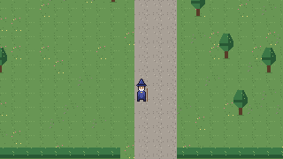

# Wizard Engine

A small, pixel-perfect 2D top-down engine written in Go, built for one game:
a wizard RPG where spells are items, the grimoire is yours, and the moon has
phases. Ebitengine supplies the window, input and GPU; everything that makes
the game itself lives here.



## Run it

You need Go 1.24 or newer (`go version`). On Linux you also need the usual
X11/OpenGL/ALSA development headers (Debian/Ubuntu names):

```
sudo apt install libgl1-mesa-dev libxcursor-dev libxrandr-dev libxinerama-dev libxi-dev libxxf86vm-dev libasound2-dev pkg-config
```

Then:

```
go run ./cmd/sandbox
```

You start at the campus gate. WASD or arrows to walk, E to talk, read or
open the ritual circle, Tab or I for the inventory, 1 to 4 to pick a quick
slot, Space or left click to cast (toward the mouse), F3 for the debug
overlay. The old wizard is on the quad north of the fountain and hands out
spell sets every time you talk to him. The ritual circle is north-west of
the quad: stand in its centre, press E, click items onto the ring and an
empty scroll into the middle, and bind. Training dummies stand on the east
side of the quad. The window is resizable and always shows whole pixels.
Windows and macOS need no extra packages.

Dev flags: `-scene snow` for the step-1 winter clearing, `-canvas 480x270`
for another view size, `-at 33,25` to spawn at a tile, `-say
old_wizard_intro` to preview a dialogue, `-inventory` / `-bind` / `-bound`
to start with the starter items and that screen open or the four spells
bound, `-autocast` to cast at the nearest dummy every 40 ticks, and
`-screenshot out.png -ticks 60` to render a frame to a PNG and exit (how the
screenshots in this repo are made).

## Layout

```
cmd/sandbox         runnable proving ground
engine/             the engine: loop + scenes, render, input, sprite, tilemap, ui
game/               game code: player, npc, items, dialogue, hud, scenes
assets/             art and data, embedded into the binary
  data/items.json      every item: name, kind, icon, keywords, description
  data/dialogue.json   every conversation: speaker, pages, gifts, follow-up
  data/spells.json     keyword table (what each keyword adds) and synergies
tools/mkplaceholders generates the stand-in art under assets/
docs/               ARCHITECTURE.md (how it fits together), ASEPRITE.md (art spec)
```

## Tests

```
go test ./...
```

The engine packages are written so the logic (camera maths, animation
timing, collision, Aseprite parsing) is testable without opening a window.
