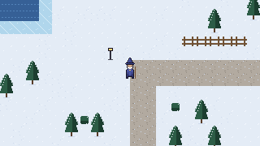

# Wizard Engine

A small, pixel-perfect 2D top-down engine written in Go, built for one game:
a wizard RPG where spells are items, the grimoire is yours, and the moon has
phases. Ebitengine supplies the window, input and GPU; everything that makes
the game itself lives here.



## Run it

You need Go 1.24 or newer (`go version`). On Linux you also need the usual
X11/OpenGL/ALSA development headers (Debian/Ubuntu names):

```
sudo apt install libgl1-mesa-dev libxcursor-dev libxrandr-dev libxinerama-dev libxi-dev libxxf86vm-dev libasound2-dev pkg-config
```

Then:

```
go run ./cmd/sandbox
```

WASD or arrows to walk, F3 for the debug overlay. The window is resizable and
always shows whole pixels. Windows and macOS need no extra packages.

`go run ./cmd/sandbox -screenshot out.png -ticks 60` renders a frame to a PNG
and exits, which is how screenshots in this repo are made.

## Layout

```
cmd/sandbox         runnable proving ground
engine/             the engine: loop + scenes, render, input, sprite, tilemap
game/               game code: player, scenes (later: items, spells, grimoire)
assets/             art and data, embedded into the binary
tools/mkplaceholders generates the stand-in art under assets/
docs/               ARCHITECTURE.md (how it fits together), ASEPRITE.md (art spec)
```

## Tests

```
go test ./...
```

The engine packages are written so the logic (camera maths, animation
timing, collision, Aseprite parsing) is testable without opening a window.
